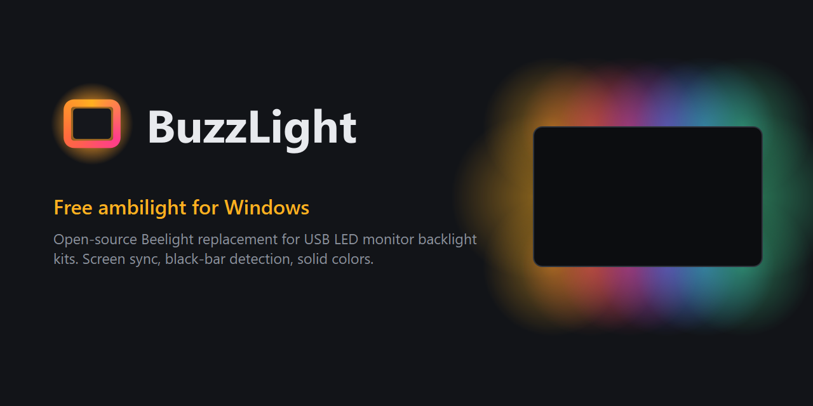

# BuzzLight



**Free, open-source ambilight for Windows and a Beelight replacement for
cheap USB LED monitor backlight kits.** BuzzLight syncs the LED strip on the
back of your monitor with the colors at the edges of your screen
(screen sync / bias lighting), or shows any solid color you pick. It talks to
the strip's USB controller directly, so you don't need Beelight, Lytmi
software or any other vendor app.

[**Download BuzzLight for Windows**](https://github.com/TylerBuza/BuzzLight/releases/latest):
one portable `.exe`, no installer.

## Which kits work?

BuzzLight works with USB LED backlight kits that use the **Artery AT32 USB
controller** (USB ID `2E3C:5740`). These kits are usually sold for PC monitors
(17" to 49", including ultrawides) and came with one of these Windows apps:

| Vendor app | Exe / install folder | Status |
|---|---|---|
| **Beelight V3.0** (by Glowworm, shown with Lytmi branding) | `Beelight.exe` in `C:\Program Files (x86)\Beelight\Beelight V3.0` | Tested (75-LED kit) |
| Other kits whose listing says "software: Beelight" | `Beelight.exe` | Should work, untested |
| Lytmi PC Neo / Screen Strip Light with the **Lytmi Station** app | Lytmi Station | Unknown: check the hardware ID below |

**Check your kit in 10 seconds:** plug in the strip, open Device Manager →
*Ports (COM & LPT)*, and look for **USB Serial Device (COMx)**. Right-click →
Properties → Details → *Hardware Ids*. If it shows `USB\VID_2E3C&PID_5740`,
BuzzLight should drive it. If your kit has a different ID, please
[open an issue](https://github.com/TylerBuza/BuzzLight/issues) with the ID
and the name of the app it came with.

Not supported (different hardware): Philips Hue Sync, Govee DreamView /
Sync Box, NZXT HUE 2 Ambient, Lytmi HDMI sync boxes and Wi-Fi/Tuya light bars,
Skydimo, and Adalight/WLED/Hyperion DIY builds.

## Features

- **Ambilight** at up to 60 FPS, using DirectX Desktop Duplication with a GDI
  fallback.
- **Ignores black bars.** On an ultrawide, 16:9 video leaves black bars at the
  sides; BuzzLight detects them and samples the edges of the actual picture.
  Letterboxed movies (bars top and bottom) work too, including subtitles
  inside the bars.
- **Natural-looking color:** averaging in linear light, adjustable saturation,
  and frame-rate-independent smoothing that still reacts fast to scene cuts.
- **Solid colors** with presets and smooth fades.
- **LED setup:** set LEDs per side, the start corner and the direction, then
  press **Identify** to light each side in its own color on the real strip.
- **Tray app:** closing the window keeps the lights running. Turn on
  **Start with Windows** to launch minimized at login. Only one copy runs at
  a time.
- **Recovers on its own** after unplugging the strip, display changes, UAC
  prompts and sleep.

## Download

Grab `BuzzLight-<version>.exe` from
[Releases](https://github.com/TylerBuza/BuzzLight/releases). It's a single
portable exe: put it anywhere and run it. **Start with Windows** (on the
Settings page) remembers where it is, and if you move the exe, opening it
once from the new spot updates the setting.

## Run from source (Windows)

```bat
python -m venv .venv
.venv\Scripts\pip install -r requirements.txt
.venv\Scripts\pythonw BuzzLight.pyw
```

## Build the exe

```bat
.venv\Scripts\pip install pyinstaller
.venv\Scripts\python -m PyInstaller BuzzLight-onefile.spec --noconfirm
```

This produces the single portable `dist\BuzzLight.exe` used for releases.
`BuzzLight.spec` builds a one-folder version instead
(`dist\BuzzLight\BuzzLight.exe`), which starts a little faster.

## FAQ

**Is this a Beelight alternative?** Yes. It replaces Beelight completely for
screen sync and solid colors, with a lighter app, black-bar detection and
Start with Windows. Close Beelight before starting BuzzLight.

**Beelight doesn't detect my strip / keeps disconnecting.** BuzzLight finds the
controller by its USB ID and reconnects automatically after unplugging, sleep
or a display change. Give it a try.

**Does it handle ultrawide monitors and movies with black bars?** Yes. On a
21:9 screen, 16:9 videos leave black bars at the sides; BuzzLight detects
them and uses the edge of the actual picture, so the LEDs don't go dark.

**Does it work on macOS or Linux?** Not yet. Screen capture is Windows-only;
the strip driver itself is cross-platform Python.

**Does it slow down games?** It captures the screen with DirectX Desktop
Duplication, the same low-overhead method screen recorders use, and only
reads thin strips along the edges.

## Notes

- Close any other LED app (e.g. Beelight) first. Only one program can use the
  strip's COM port.
- Settings live in `%APPDATA%\BuzzLight\settings.json`. When BuzzLight runs
  without a console, its log goes to `%APPDATA%\BuzzLight\buzzlight.log`.
- `BUZZLIGHT_PORT=COM5` forces a specific port.
- The controller protocol is documented in [docs/PROTOCOL.md](docs/PROTOCOL.md).

## Development

```bat
.venv\Scripts\pip install pytest
.venv\Scripts\python -m pytest tests
```

| Module | Role |
|---|---|
| `buzzlight/device/` | Packet codec (`protocol.py`), port discovery, and `Strip`, the serial I/O thread |
| `buzzlight/ambilight/` | Screen capture, black-bar detection, sampling and smoothing, plus the engine thread |
| `buzzlight/layout.py` | Where each LED sits around the screen |
| `buzzlight/controller.py` | App state: modes, power and brightness, settings persistence |
| `buzzlight/ui/` | Qt window, LED preview, tray, theme |

## License

MIT. See [LICENSE](LICENSE).
